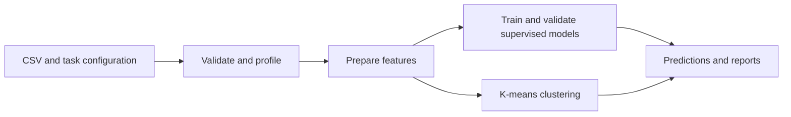

# Tabular ML Toolkit

### Unknown Dataset Hackathon · EECE 490

A Python program that turns an unfamiliar CSV table into **predictions and a
structured data profile**. It handles classification, regression, and clustering
through one command, with automatic preparation and a CPU time budget.

[Quick start](#quick-start) · [How it works](#how-it-works) ·
[Student guide](docs/STUDENT_GUIDE.md) · [Results](docs/VALIDATION.md) ·
[Input/output contract](docs/CONTRACT.md)

## What it does

| Task | Models | Output |
|---|---|---|
| Classification | Logistic regression, decision tree, random forest | Original class labels and probabilities |
| Regression | Ridge regression, decision tree, random forest | Numeric predictions |
| Clustering | K-means; mini-batch K-means for larger tables | Requested number of groups |

The program handles missing values, different scales, numeric and categorical
columns, constants, duplicates, unseen categories, and imbalanced classes.
It validates inputs, reports data statistics, and saves completed predictions
so a later timeout can retain a usable result. Running predictions needs no
internet, GPU, AI service, or downloaded model.

This is a student project built for the Unknown Dataset Hackathon in EECE 490.
It follows the supplied overview using a **provisional CSV/JSON interface**;
the organizer's detailed contract and assessment environment were not supplied.
See the [requirement checklist](docs/REQUIREMENTS.md) for the exact scope.

## Quick start

Use **Python 3.12**. Clone or download this repository, then open its folder.
Installation needs internet access; prediction runs do not.

**Windows PowerShell**

```powershell
python -m venv .venv
.\.venv\Scripts\python.exe -m pip install -r requirements.txt
.\.venv\Scripts\python.exe run.py --config examples/classification/config.json
.\.venv\Scripts\python.exe check_output.py examples/classification/results --expected-rows 20
```

**Linux / macOS**

```sh
python3.12 -m venv .venv
.venv/bin/python -m pip install -r requirements.txt
.venv/bin/python run.py --config examples/classification/config.json
.venv/bin/python check_output.py examples/classification/results --expected-rows 20
```

From here, `python` means the Python executable in that environment. Try all
three included examples:

```sh
python run.py --config examples/classification/config.json
python run.py --config examples/regression/config.json
python run.py --config examples/clustering/config.json
```

The examples use small generated datasets. Each writes a `results/` folder
beside its configuration. For classification, inspect `predictions.csv` and
`probabilities.csv`; `run.json` identifies the chosen model and validation score.

## How it works



1. **Inspect:** check schemas and feature types; summarize missingness,
   distributions, constants, and duplicates. Exclude the target and declared ID.
2. **Prepare:** remove training constants and duplicates, fill numeric values
   with medians, standardize numbers, and fill/one-hot encode categories.
   Pool rare categories to limit expansion. Learn transformations from training
   rows and reuse them on validation and evaluation rows.
3. **Learn:** compare a constant baseline and three supervised candidates on
   one holdout, stratified for classification. Try refitting the winner on all
   labelled rows. Tiny/rare-class cases use a fixed decision tree with fallback.
   Clustering uses the supplied group count, without reading target labels.
4. **Return:** write predictions, probabilities where applicable, the raw-data
   profile, and diagnostics. The default 55-second processing budget leaves
   margin against the overview's 60-second limit.

The model set is intentionally small. A random forest is an explained extension
of decision trees: 60 trees vote or average their predictions. The
[course mapping](docs/COURSE_ALIGNMENT.md) distinguishes confirmed course topics
from extensions. All application logic is Python, using pandas, NumPy, and
scikit-learn implementations.

## Use your own data

```sh
python run.py --task classification --train train.csv --test test.csv --target outcome --output results
python run.py --task regression --train train.csv --test test.csv --target price --metric rmse --output results
python run.py --task clustering --train customers.csv --n-clusters 4 --output results
```

Every CSV needs a header. Supervised training includes the target; evaluation
contains the same feature columns without that target. Supply
`--id-column customer_id` to preserve identifiers and exclude them from learning.
Declared categorical codes and IDs such as `007` retain their leading zeros.

A JSON config is easier for repeatable runs. Its paths resolve beside the file;
explicit command-line arguments override config fields.

```json
{
  "task": "classification",
  "train": "train.csv",
  "test": "test.csv",
  "target": "outcome",
  "feature_types": {"age": "numeric", "contract": "categorical"},
  "metric": "accuracy",
  "seed": 42,
  "time_budget": 55,
  "output": "results"
}
```

See [the contract](docs/CONTRACT.md) for all options, supported metrics, type
inference, error handling, and detailed output fields. Error metrics are
negated for internal selection, so larger validation scores always win.

| Output | Purpose |
|---|---|
| `predictions.csv` | Row IDs and predictions in input order |
| `probabilities.csv` | Classification probabilities, ordered by the saved class list |
| `profile.json` | Types, missing values, basic statistics, constants, and duplicates |
| `run.json` | Selected model, candidates, scores, timing, and warnings |
| `result.json` | Complete authoritative result |

Use a separate output folder for concurrent runs and trust outputs only after a
successful exit. Files are replaced individually; a failed run can leave older
outputs. The output checker validates consistency across JSON and CSV files.

## Tests and measured results

```sh
python -m pip check
python -m unittest discover -s tests -v
python benchmark.py --output practice --time-budget 15
```

**47 local tests passed** on the documented Windows/Python 3.12 environment.
They cover preprocessing isolation, malformed inputs, probabilities, rare
classes, missing and extreme values, nonlinear learning, real teaching datasets,
clustering, and forced timeout recovery.

[GitHub Actions](https://github.com/jean-pierreaouad/unknown-dataset-hackathon/actions) is configured to install the pinned dependencies,
run the suite, and check all three examples on Windows and Linux. Its run status
is separate from the recorded local measurements.

The nine-case benchmark uses **synthetic development data**, with truth kept
outside the prediction program. Selected results:

| Example | Metric | Measured result |
|---|---|---:|
| Nonlinear classification | Accuracy | 96.4% |
| Linear regression | R-squared | 0.996 |
| Nonlinear regression | R-squared | 0.896 |
| Mixed positive-target regression | R-squared | 0.940 |
| Three separated clustering examples | Adjusted Rand index | 1.000 |
| Larger classification: 20,000 training rows, 41 features | Accuracy / elapsed time | 94.3% / 21.3 seconds |

These are local development measurements, not official contest scores. All nine
benchmark outputs passed the project checker. The [validation report](docs/VALIDATION.md)
includes the full comparison with the earlier, more complex version and records
where simplification reduced quality.

## Explore the code

| File | Responsibility |
|---|---|
| `automl/data.py` | Load, validate, and profile tables |
| `automl/features.py` | Shared training-only preparation |
| `automl/models.py` | Supervised model choices and metrics |
| `automl/worker.py` | Split, train, compare, and predict; run clustering |
| `run.py` | Command-line entry point, time control, output writing |
| `check_output.py` | Check output consistency |
| `tests/test_project.py` | Behavior and learning tests |

Start with the [student guide](docs/STUDENT_GUIDE.md) for a complete walkthrough,
Python vocabulary, and questions to practice explaining as a team.

## Assumptions and limits

- The task, target, and clustering group count are supplied; the program does
  not guess them. Only numeric/categorical tables receive specialized handling.
- One holdout can select an inferior model by chance. K-means favors compact
  groups; identical points cannot produce meaningful geometric separation.
- Category pooling and clipping numeric magnitudes above `1e30` can lose signal.
  CSV parsing follows pandas' default missing-value tokens.
- Completed checkpoints survive later timeouts, but a run fails if no initial
  checkpoint finishes. Memory is not externally capped. Local timing does not
  establish a universal 60-second guarantee.
- Official input/output fields, scoring formulas, data limits, and the assessment
  image remain unverified. There is no claim of an official score or grade.

## Team

**Jean-Pierre Aouad · Maher Karam · Alex Yammine · Marc Abou Mikheal**

Built as a four-person team for EECE 490. The team-size exception and reported
course deadline are recorded in `TEAM.json`. Earlier implementations remain in
Git history; the organizer determines which commit is assessed.
